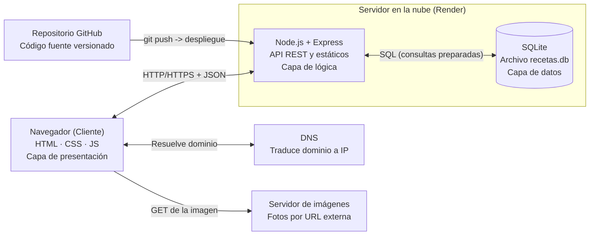

# Topología del sistema — Recetario de la clase

La topología de este sistema web describe sus nodos (navegador, servidor, base de datos y servicios externos) y los enlaces por los que se comunican. Sigue una arquitectura **cliente-servidor en tres capas** (Presentación, Lógica y Datos), preparada para ejecutarse tanto de forma local como desplegada en la nube.

## Diagrama de topología

| Capa | Responsabilidad | Tecnología y archivos | Nodo |
| --- | --- | --- | --- |
| **Presentación** | Mostrar y capturar datos de la interfaz e interactuar con el usuario | HTML5, CSS3, JavaScript (`public/index.html`, `public/css/estilos.css`, `public/js/app.js`) | Navegador (cliente) |
| **Lógica** | Validar, aplicar reglas de negocio, servir estáticos y responder HTTP | Node.js (22.13+), Express (`server.js`) | Servidor Node.js + Express |
| **Datos** | Guardar y recuperar información de forma persistente con consultas preparadas | SQLite (`node:sqlite`, `db.js`, archivo `recetas.db`) | Base de datos SQLite |